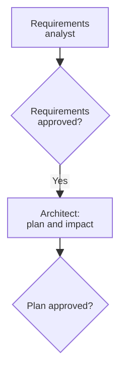
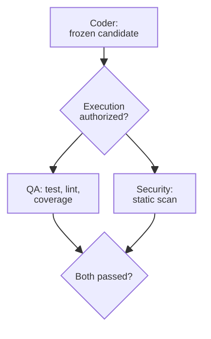
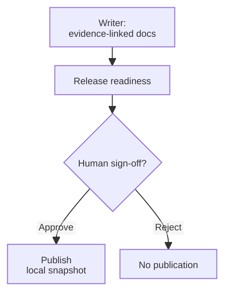
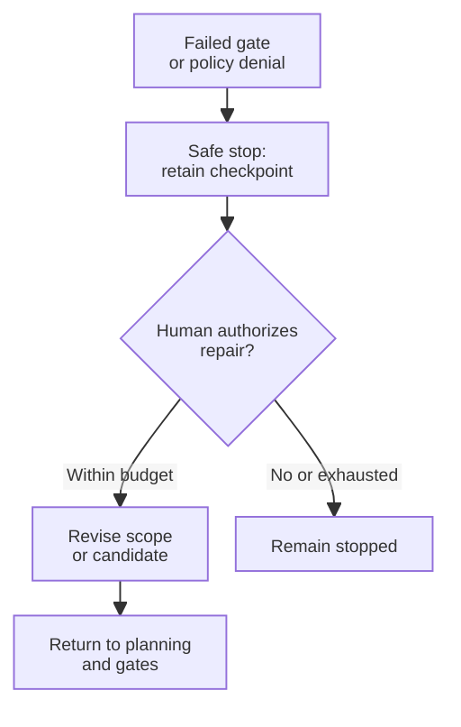
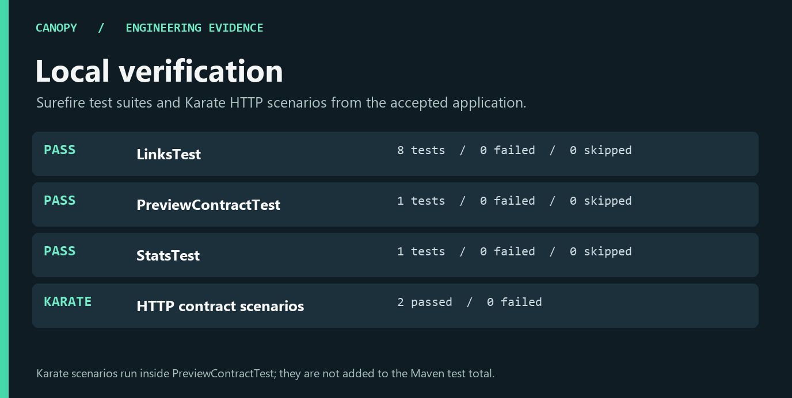
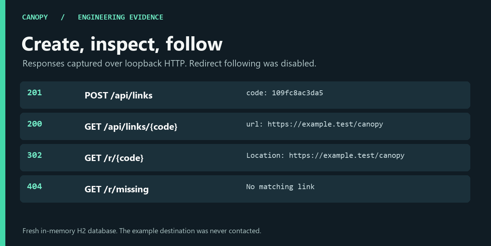
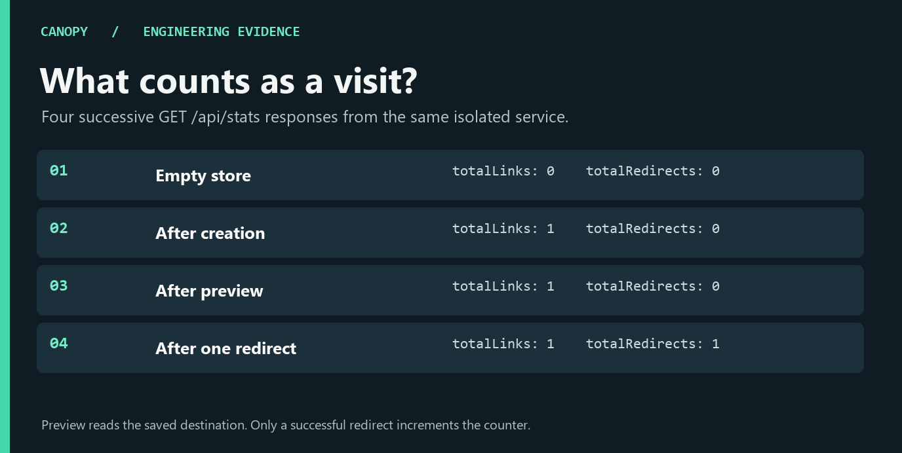
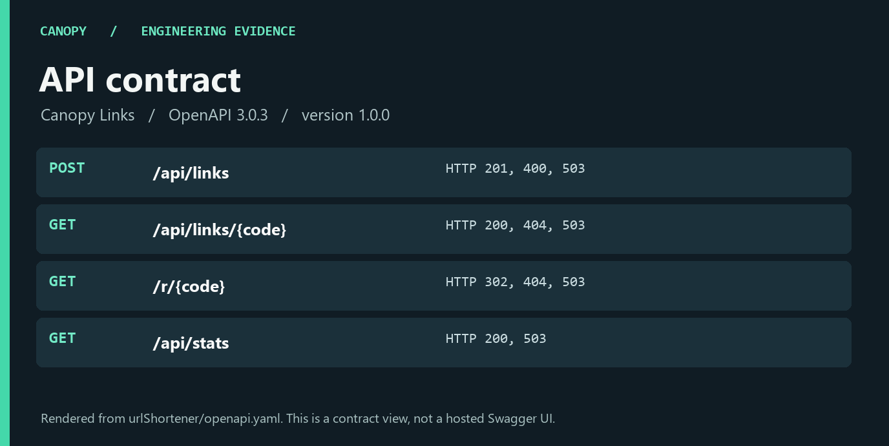

# Canopy - Agentic AI Platform

**Canopy** is the fictional brand name for a governed, multi-agent AI platform for the software development lifecycle. Whether a requirement is clear or needs clarification, the platform guides it toward a reviewable change, with evidence of what was built, why, and how it was verified.

The **control plane** is the part of Canopy that coordinates the engineering work. Agents perform tasks such as writing code or running tests; the Python control plane determines which tasks may run next, which tools each agent may use, and when a person must decide. For example, passing tests alone cannot release a change: the security check must also pass, and a human must review the evidence and approve the release. This is **controlled autonomy**: agents do the work within defined boundaries; humans own oversight, approvals, and final quality.

The **URL Shortener** is the first product built through Canopy. This Java service demonstrates how the platform takes a product requirement from intent to acceptance. In this repository, **released** means a verified source snapshot was accepted into a local workspace; it does not mean the service was deployed.

| Start here | Purpose |
|---|---|
| [Current product intent](docs/product/current/INTENT.md) and [PRD](docs/product/current/PRD.md) | Why Canopy exists, who makes decisions, and the observable requirements for the platform and its first product. Working documents, distinct from historical approvals. |
| [`engineering/control.py`](engineering/control.py), [graph](engineering/sdlc_graph.py) | Run, inspect, authorize, resume, stop, revise, export or roll back a project. |
| [Workers and tool adapters](engineering/sdlc_agents.py) | Requirements, architecture, candidate assembly, Maven verification, security, documentation and readiness. |
| [Control policy](policies/control.json), [project registration](projects/links.json) | Agent/tool grants, budgets, change scope, build adapter and contract expectations. |
| [Architecture and extension contract](docs/architecture.md) | How to onboard another project or build adapter without putting service logic in the scheduler. |
| [Signed reviewer mode](docs/signed-review.md) | Opt a new workspace into key-bound decisions; the operator signs outside Canopy. Normal demo runs do not claim authenticated review. |
| [`scenarios/`](scenarios), [input specification](SPEC.md) | Greenfield build, brownfield enhancement and bug fix, ambiguity and recovery. |
| [`urlShortener/`](urlShortener) | Previously human-accepted application, directly buildable; [live images below](#accepted-application-in-pictures). |
| [New service inputs](examples/projects/links-service), [brownfield changes](examples/projects/links-improvement) | Inputs for the full graph. Replays publish into isolated workspaces, **not** over the existing human-accepted service. |
| [Engineering summary](docs/FINAL_ENGINEERING_SUMMARY.md) | Decisions, actual verification, boundaries and remaining risks. |

## Run the control plane

Use `engineering\control.py` for all new runs. `engineering\flow.py` is retained for inspecting historical approvals.

**Choose how you want to use Canopy.** To act as the reviewer and decide what advances, follow the supervised walkthrough below. To see all three scenarios execute with clearly labeled simulated approvals, skip to [Replay the demonstrations](#replay-the-demonstrations). To run only the previously accepted web service, skip to [Run the first product directly](#run-the-first-product-directly).

### 1. Start a supervised run

Open PowerShell in `canopy-agentic-sdlc` (the folder containing `mvnw.cmd`). You need Python 3.10+, Java 21 and first-time access to Maven dependencies. The default run needs no API key, model server or Docker daemon.

```powershell
python -m pip install -r engineering\control-requirements.txt
$ws = '.canopy\demo-work'
python engineering\control.py --workspace $ws run trial scenarios\greenfield\scenario.json
```

| Argument | What it means |
|---|---|
| `--workspace $ws` | Where Canopy stores this run's ledger, artifacts and eventual application checkout. Use a new directory for the first greenfield run. Pass the **same path** on every subsequent command, before the command name. |
| `run` | Create a run and execute only until the first decision or stop. Use this once; use `status` or `resume` to return to an existing run. |
| `trial` | A **run ID you choose**, not a command, mode or built-in scenario. Use this exact spelling in later commands. IDs are unique within a workspace: 1–60 letters, digits, hyphens or underscores. |
| `scenarios\greenfield\scenario.json` | The input file: `project` selects a registered adapter (`links`), `kind` selects the starting context (`greenfield`, `brownfield` or `ambiguous`), `request` states the desired behavior, and `criteria` lists observable outcomes. Start with the [provided input](scenarios/greenfield/scenario.json); you do not have to author JSON for this walkthrough. |

**Expected first output:** JSON with `"run": "trial"`, `"revision": 1`, `"state": "awaiting_approval"`, and `"gate": "requirements_approval"`. This is a successful pause, not a build failure. No application has been published.

### 2. See where the run is and what you are approving

```powershell
python engineering\control.py --workspace $ws status trial
python engineering\control.py --workspace $ws inspect trial requirements
```

**`status trial` means “where is the run named `trial`?”** It reads the saved state without advancing it. `state` tells you whether action is needed; `gate` names the pending decision; `digest` identifies the exact decision subject. `done` maps completed stages to their artifact hashes. Use the top-level **`digest`**, not a hash from `done`, when approving.

**`inspect trial requirements` means “show the requirements artifact for `trial`.”** `trial` is the run ID; `requirements` is the stage name. The output is JSON containing the original request, interpreted intent, assumptions, open questions and numbered acceptance criteria. **Your job:** decide whether those criteria describe what the user actually wants. `inspect` neither approves nor executes anything. It works only for completed stages; `inspect trial qa` cannot return test results before tests run.

### 3. Make one decision, then advance

After reviewing the artifact, read the current decision digest and give your own rationale. This example approves **only the requirements**:

```powershell
$s = python engineering\control.py --workspace $ws status trial | Out-String | ConvertFrom-Json
python engineering\control.py --workspace $ws approve trial $s.digest "The criteria cover creation, expiry, redirects and statistics."
python engineering\control.py --workspace $ws resume trial
```

For the first three approvals, `approve` records your reason and returns `pending`; it **does not run the next stage**. `resume` executes newly eligible work and returns the next state. For the sample run, the next gate is now `plan_approval`. Repeat the review/decision sequence **one gate at a time**, re-reading `status` for a fresh digest and writing a reason appropriate to that gate. Do not approve all gates in a loop.

| When `gate` says… | Run `inspect trial` followed by… | What you decide |
|---|---|---|
| `requirements_approval` | `requirements` | Are the scope, assumptions and success criteria right? |
| `plan_approval` | `design` | Are the planned file changes, affected interfaces, risks and baseline acceptable? |
| `execution_approval` | `implementation` | Is this exact candidate appropriate to build, test and scan locally? After approval, `resume` runs QA and Security; this step can take several minutes. |
| `release_approval` | `qa`, `security`, `documentation`, then `readiness` (four separate `inspect` commands) | Do the actual test results, scan findings, documentation and rollback target justify accepting this snapshot? **Final approval publishes it immediately** and returns `released`; no further `resume` is required. |

If requirements are unclear, use `inspect trial requirements` to read the questions, then `revise trial "Clarified requirement" "Why this resolves the question"` and `resume trial`. To decline a pending approval, use `reject trial $s.digest "Reason"` instead of `approve`. If the state is `safe_stop`, read the error before taking action; see [State, recovery and evidence](#state-recovery-and-evidence). All these commands take the same `python engineering\control.py --workspace $ws` prefix.

If the run started without acceptance criteria, supply them during clarification:

```powershell
python engineering\control.py --workspace $ws revise trial "Preview an existing link without visiting it" "Owner clarified preview semantics" --criterion "A known code returns the stored destination" --criterion "A preview leaves the visit count unchanged"
python engineering\control.py --workspace $ws resume trial
python engineering\control.py --workspace $ws inspect trial requirements
```

`--criterion` replaces the criterion list and removes obsolete test mappings; it does not approve the new criteria. Without explicit criteria, the analyst can propose a measurable clause such as “Return 404 for an unknown link.” If it cannot identify a measurable outcome, the run stays paused. Review the interpretation before approving: extracting an outcome from text does not prove that the project implements it.

### 4. Find the application and take the evidence with you

| Output | Location for this walkthrough |
|---|---|
| Accepted Java application | `.canopy\demo-work\urlShortener\` after final approval. It does **not** overwrite the repository's existing `urlShortener\` or start a server. See [how to run the published application](#run-the-enhanced-service-from-a-supervised-workspace). |
| Durable run state | `.canopy\demo-work\.canopy\control.sqlite`. Reopen PowerShell, set `$ws` again, and use `status trial` to pick up where you left off. |
| Readable review bundle | Choose a **new output directory** with `export`, as below. Open `OUTCOME.md` for the decision, `AGENT_TRACE.md` for the sequence and rationale, and `METRICS.md` for measurements. |

```powershell
python engineering\control.py --workspace $ws export trial .canopy\trial-evidence
Get-Content .canopy\trial-evidence\OUTCOME.md
```

### Replay the demonstrations

To reproduce **all three demonstrations**, run `python -B engineering\replay.py --authorize-demo`. This intentionally simulates human decisions in disposable workspaces, labels each decision as a fixture, and exports actual gate results to `scenarios/<kind>/evidence/`. It does not grant authority over your existing application. The greenfield and brownfield share a checkpoint; ambiguity starts independently.

| Demonstration | Read the input | Inspect the result |
|---|---|---|
| Greenfield | [Create a service from an empty checkpoint](scenarios/greenfield/scenario.json) | [Agent trace](scenarios/greenfield/evidence/AGENT_TRACE.md) and [metrics](scenarios/greenfield/evidence/METRICS.md) |
| Brownfield | [Add a response policy and fix incorrect visit counts](scenarios/brownfield/scenario.json) | [Agent trace](scenarios/brownfield/evidence/AGENT_TRACE.md) and [before/after rollback hashes](scenarios/brownfield/evidence/RESTORATION.md) |
| Ambiguous | [Clarify scope and reject an out-of-policy change](scenarios/ambiguous/scenario.json) | [Agent trace](scenarios/ambiguous/evidence/AGENT_TRACE.md) and [metrics](scenarios/ambiguous/evidence/METRICS.md) |

For cross-run results see [`scenarios/metrics.json`](scenarios/metrics.json). For an actual supervised run, **do not use `replay.py`**: use `control.py` in your own workspace and make each decision yourself.

**Additional brownfield demonstration: Swagger UI and request telemetry.** Run the following from the repository root, using an evidence directory that does not already exist:

```powershell
python -B engineering\replay_observability.py --authorize-demo --evidence .canopy\swagger-evidence
```

The replay first publishes greenfield into a temporary workspace. It then applies the [hash-pinned proposal](scenarios/observability-api-docs/proposal) to that exact baseline, runs QA and security on the changed candidate, and exports the results. Approvals are simulated; no server or modified checkout is left running. The tests fetch the Swagger UI, its local assets and the existing OpenAPI contract over HTTP, and inspect structured completion logs on success and exception paths. To try the UI in a **retained supervised checkout**, run the [scenario](scenarios/observability-api-docs/scenario.json) after greenfield in the same workspace, approve its gates, then set `$env:DOCS_ENABLED='true'` before starting the changed service. Open `/docs/index.html`; the contract is at `/docs/openapi.yaml`. Both routes are disabled by default.

### Quick review: a second workload on the same engine

The [inventory requirement](scenarios/inventory/scenario.json) was committed at `91d16c2`, after the engine baseline `e85f99a` and before any inventory implementation. This simulation uses a new [project manifest](projects/inventory.json), Java/Maven workload and replay driver. It does not change the scheduler, workers or policy. The candidate defect and repair are scripted; the Maven builds, HTTP requests, gate decisions and checkout restoration actually execute. Approvals below are **simulated**, not independent human sign-off.

```text
Inventory reservation API | 2026-11-25 UTC | condensed from the run trace
20:15:33  r1  START      Empty managed checkout; 10 units of stock required at startup.
20:15:35  r1  EXECUTE    Requirements, plan and execution approved (simulation); QA and security dispatched.
20:15:48  r1  QA FAIL    2 of 4 tests failed. Reserve 11 from 10: HTTP 409, but stock was -1; expected 10.
20:15:48  r1  SAFE-STOP  Security passed. The failed QA gate still blocked the join; no checkout published.
20:15:49  r2  RE-PLAN    Repair authorized (simulation): check stock before decrement. Prior results invalidated.
20:15:52  r2  EXECUTE    Requirements, revised plan and repaired candidate approved again (simulation).
20:16:10  r2  VERIFY     4/4 tests passed, including live HTTP; 11/11 lines covered; lint and security passed.
20:16:10  r2  RELEASE    Readiness passed; simulated sign-off published local snapshot 38dc66eb70e2.
20:16:10  r2  ROLLBACK   Restored empty baseline 44136fa355b3; replay verified no managed files remained.
```

[Full event trace](scenarios/inventory/evidence/AGENT_TRACE.md) · [Measured metrics](scenarios/inventory/evidence/METRICS.md): **37.29 s** elapsed, **21.24 s** from QA failure to recovery, one repair and one rollback. To reproduce, run `python -B engineering\replay_inventory.py --authorize-demo --evidence .canopy\inventory-evidence` from the repository root with a new output directory. The inventory is in-memory and resets on restart; nothing is deployed.

## Execution graph

The diagrams are intentionally split at artifact boundaries. Read each top to bottom. The table is authoritative even in Markdown viewers without Mermaid support.

**1. Understand and authorize**



**2. Build and verify the same candidate**



**3. Sign off or recover**



| Node / owner | Entry gate | Output and exit gate |
|---|---|---|
| Requirements Analyst | Valid scenario and registered project | Versioned intent, acceptance IDs, questions and assumptions. Unresolved ambiguity pauses the graph. |
| Human: requirements | Inspect normalized request | Approval binds this interpretation, not a future implementation. |
| Planner / Architect | Approved requirements + accepted checkpoint | Contract paths, schema inventory, task order, affected files, risk and proposed diff. Change budgets must pass. |
| Human: plan | Inspect exact proposed changes | Authorizes implementation against this baseline; a revised plan needs a new approval. |
| Coder | Approved design and unchanged checkpoint | Assemble candidate from the reviewed diff; never edit the accepted checkout at this stage. |
| Human: execution | Inspect full candidate | Authorizes local execution of its build and tests, not release. |
| QA | Frozen candidate and execution approval | Run `clean verify` in a fresh directory; require real test, JaCoCo and Checkstyle evidence. |
| Security & Compliance | Same candidate and execution approval | Compile and run SpotBugs + FindSecBugs separately; missing evidence or a blocking finding stops the run. |
| Documentation | **Join:** QA and security both passed | Render API contract, README, change list and ADR from artifacts—not from planned success. |
| Release Readiness | Joined evidence, documentation and checkpoint | Check candidate identity across both branches and record rollback target. |
| Human: release | Inspect readiness, both gate results and generated documents | Explicit sign-off publishes the snapshot; failure, denial or stale evidence cannot publish. |

`inspect RUN design` includes work packages with prerequisite IDs, changed file paths, and requirement IDs. The coder applies these packages in topological order and rejects missing or duplicate outputs. Brownfield impact compares old and new HTTP operations, identifies the Maven module and schema changes, and lists source references from affected application classes. Those references are evidence for reviewing data flow, not a runtime call trace.

Before requesting release approval, Canopy verifies the event chain and completed artifacts against recorded approvals and successful gates, then stores metrics through documentation. The readiness reviewer independently checks the security disposition and rollback checkpoint. Exported `pre-signoff-evidence.json` and `pre-signoff-metrics.json` show what the reviewer had **before** the decision; `metrics.json` includes later events such as release and rollback.

## Feedback loops, human judgment and configurable controls

**Canopy can advance work, but it cannot approve it.** At a pending gate, use `status RUN` to see why the run is waiting and `inspect RUN STAGE` to read the artifact. The four decisions below bind to the exact revision and artifact digest. Approval at one gate is not permission for the next.

| Human checkpoint | Judgment the reviewer owns |
|---|---|
| Requirements | Are the assumptions acceptable and the criteria measurable? If not, `revise` the request or criteria instead of approving. |
| Plan | Does the proposed diff solve the problem, and is its impact acceptable against this checkpoint? For brownfield work, inspect affected APIs, files and regression risk. |
| Execution | Is this exact candidate safe to build and test in the chosen environment? Approval starts independent QA and security checks; both must pass. |
| Release | Do the results apply to the same candidate, and is the rollback target correct? Sign-off publishes a **local snapshot**, not a production deployment. Reject if the evidence is insufficient. |

| Feedback loop | What the operator controls | Evidence |
|---|---|---|
| Clarify and re-plan | `revise` records why the intent changed, invalidates prior stage results and starts requirements review again. Old approvals cannot authorize the revision. | [Ambiguous run: clarification, protected-path denial and revised plan](scenarios/ambiguous/evidence/AGENT_TRACE.md) |
| Repair and verify | A failed QA or security gate stops publication. After inspecting the failure, use `recover` to re-plan against the approved requirements, or `revise` to supply a scoped fix. Both paths out of safe-stop consume the repair budget; neither waives the failed gate. | [Recovery logic and budget](engineering/control.py) |
| Stop or undo | `stop` pauses an open run; `resume` alone cannot clear a safe-stop. After local release, `rollback` restores the previous managed snapshot only while that release is current. | [Brownfield before/after checkpoint hashes](scenarios/brownfield/evidence/RESTORATION.md) |

**Where to set the boundaries:** [Control policy](policies/control.json) sets tool grants, blocked patterns and severities, and change limits. The defaults are **3 repairs per run**, 90 changed files, 6,500 changed lines and 180,000 bytes per input file. The [project manifest](projects/links.json) sets editable paths and registers exceptional patches by baseline and file hash. These inputs are captured when a run starts; a reviewer cannot approve away a blocking security finding. Use [signed review](docs/signed-review.md) when decisions must prove possession of an enrolled key.

The [Swagger and telemetry trace](scenarios/observability-api-docs/evidence/governed/AGENT_TRACE.md) shows the no-repair path: four simulated decisions and both verification branches passing. It demonstrates enforcement of the checkpoints, **not** independent human judgment; use the supervised walkthrough for that.

## Autonomy, tools and policy controls

- **Unit of authority.** Each [graph node](engineering/sdlc_graph.py) declares an owner, input producers, output, tool and exit gate. The scheduler resolves ready nodes from successful artifacts. Workers cannot approve themselves, choose shell commands, or release a checkout. Only QA and Security become eligible together.
- **Tool grants.** [`policies/control.json`](policies/control.json) maps each worker to a named operation. The Maven adapter uses fixed argument lists, a bounded runtime, an environment allowlist and separate build directories. A denied tool or protected-path change produces a failed gate event. A Maven process is **not** a security sandbox: review code before authorizing it, and execute untrusted code only in an isolated OS environment.
- **Change control.** The project manifest declares agent-writable source prefixes. Supplied code cannot change the Maven build, control plane, policies or existing trusted tests. A candidate is limited to 90 changed files, 6,500 changed lines and 180,000 bytes per input file. A project pack is a **trusted operator input**; review it like build configuration. Before publication Canopy checks for conflicting local edits.
- **How agents perform work.** Deterministic workers operate offline on reviewed project inputs. A scenario can supply an externally generated `proposal` mapping allowed paths to full source. Alternatively, `run ... --local-model PORT:MODEL` explicitly permits a local OpenAI-compatible coding model on `127.0.0.1`. It receives candidate source and criteria, never shell access. Its changes enter the same design review. If inference is unavailable or malformed, the plan records a fallback to deterministic inputs. The offline demo does **not** claim a model wrote fresh code on every run.
- **Approvals.** `interactive RUN` prompts for a decision and rationale. `policy RUN FILE` accepts only an exact run, gate and digest match. No default, wildcard or unattended high-impact approval is provided. A policy file has shape `{"decisions":[{"run":"trial","gate":"plan_approval","digest":"<reviewed digest>","decision":"approve","reason":"<review rationale>"}]}`. Rejecting is supported. There is no override that turns an open blocking security result green.
- **Data boundaries.** The platform stores code snapshots, requests, decision reasons and bounded diagnostics locally. Do not submit secrets or personal data in scenario inputs. The service uses correlation identifiers rather than destination URLs in its request log. Static scanning and scoped logging reduce risk; they do not establish regulatory compliance.

## State, recovery and evidence

Each workspace has `.canopy/control.sqlite`. The store keeps versioned run state, immutable content-addressed artifacts, the accepted project pointer, and a per-run hash chain of events. Every worker request records its tool, revision and upstream artifact hashes; gate completion records the output hash and latency. Approval digests also bind the policy and project configuration. SQLite triggers prevent normal update/delete of events; a local database administrator is **not** outside the trust boundary.

| Situation | What happens / operator action |
|---|---|
| Ambiguous requirement or changed intent | `revise RUN "new requirement" "reason"` preserves the original and invalidates downstream work. Requirements and design must be reviewed again. |
| Failing QA or security gate | Both parallel results are captured. Publication and the join are blocked; accepted files stay untouched. Inspect `status`. `recover RUN "reason"` authorizes another attempt and routes failed quality work back through planning and approval. |
| Code repair | `revise RUN "clarified scope" "reason" --proposal-file repair.json` supplies a bounded repair. Retrying is not evidence that the defect is fixed: both quality branches must pass again. |
| Crash or operator pause | Inspect `status` first. For an abandoned execution, use `stop RUN "reason"`, then `recover RUN "reason"` and `resume RUN`. Late worker results cannot authorize publication. |
| Budget exhaustion | Three authorized recoveries maximum per run. Further retries are denied; preserve the evidence and open a reviewed successor. |
| Regression after local release | `rollback RUN "reason"` restores the previous managed files only if this run is still current. It does not undo a database migration or deployed service. |

**Recovery loop (not a shortcut around review):**



`export RUN NEW_DIRECTORY` produces `AGENT_TRACE.md`, `trace.json`, `artifacts.json`, `metrics.json`, `METRICS.md`, `OUTCOME.md`, and, when available, generated documentation and a release checklist. `metrics NEW_FILE` summarizes the workspace across runs. **MTTR is null when no failed gate later recovered**; it is not reported as zero. Per-stage latency is worker time; end-to-end time includes time spent waiting for approval.

## Run the enhanced service from a supervised workspace

To **build the enhanced greenfield service directly** without making any approval decisions, run `.\mvnw.cmd -Penhanced -pl :links-service clean verify` from the Canopy root. This verifies the project input; it does not advance the SDLC graph or publish a release. For the governed end-to-end path, use the supervised walkthrough instead.

After you accept the final gate in the example workspace above, its published project is `.canopy\demo-work\urlShortener`. The root `urlShortener\` remains the earlier accepted application pictured below.

```powershell
.\mvnw.cmd -B -ntp -f .canopy\demo-work\urlShortener\pom.xml clean verify
java -jar .canopy\demo-work\urlShortener\target\links-service-1.0.0.jar
```

In another terminal:

```powershell
$base = 'http://127.0.0.1:8080'
$link = Invoke-RestMethod -Method Post "$base/api/v1/shorten" -ContentType 'application/json' -Body '{"long_url":"https://example.test/guide","ttl_seconds":600}'
curl.exe -s -D - -o NUL "$base/$($link.code)"
Invoke-RestMethod "$base/api/v1/stats/$($link.code)"
Invoke-RestMethod "$base/health"
```

For optional PostgreSQL/Redis execution, stop the standalone service, keep the built JAR, set `DATABASE_PASSWORD` in the local environment, and run `docker compose up --build` **from the published application directory**. Use `docker compose down` to stop it. Compose is an operator action, not an agent permission. CI-style scenario gates use in-memory H2, migration tests and a Redis fallback test; they do not prove a live cluster or production rollout.

## Accepted application in pictures

These are rendered measurements of the existing `urlShortener/` checkout, not screenshots of a hosted service or results from the newer scenario candidate.









To refresh: run the accepted application's `clean verify` below, install Pillow alongside PyYAML, then run `python docs\images\capture.py`. Capture starts a loopback-only process on a random port with a fresh in-memory H2 database and stops it afterward.

## Run the first product directly

The standalone `urlShortener` app has its own [OpenAPI spec](urlShortener/openapi.yaml), but it does **not** serve Swagger UI. Use this spec for its endpoints, such as `POST /api/links`. Setting `DOCS_ENABLED=true` does not add `/docs/index.html` to this app.

The [spec under `examples/projects/links-service`](examples/projects/links-service/openapi.yaml) belongs to the blueprint Canopy uses to build the **enhanced** service, which also supports `POST /api/v1/shorten`. The [Swagger brownfield scenario](scenarios/observability-api-docs/scenario.json) adds the UI to the workspace copy of `urlShortener` without changing the standalone module. In that changed service, enable `DOCS_ENABLED=true` to serve `/docs/index.html` and `/docs/openapi.yaml`.

**Local quick start (Windows PowerShell).** This runs the accepted application in `urlShortener\`, without starting the engineering platform. You need a **JDK 21** on `PATH`, `curl.exe`, and network access on the first build to download Maven and dependencies. The repository supplies the Maven wrapper; Spring Boot includes the web server and H2 database. No separate Maven installation, Python, Docker, Redis, PostgreSQL, or API key is required.

**Terminal 1:** From the Canopy repository directory (the one containing `mvnw.cmd`), build, run the tests, and start the service:

```powershell
java -version
.\mvnw.cmd -B -ntp -f urlShortener\pom.xml clean verify
java -jar urlShortener\target\links-1.0.0.jar
```

Wait for Spring Boot to report that it has started. **Terminal 2:** Create a link and test it over HTTP. Use `curl.exe` rather than the PowerShell `curl` alias:

```powershell
$base = 'http://127.0.0.1:8080'
$link = '{"url":"https://example.test/docs"}' | curl.exe -fsS -H 'Content-Type: application/json' --data-binary '@-' "$base/api/links" | ConvertFrom-Json
$link                                     # 201 Created: code and relative shortUrl
curl.exe -sS -i "$base/api/links/$($link.code)"  # 200: stored URL; no visit counted
curl.exe -sS -i "$base$($link.shortUrl)"         # 302: Location: https://example.test/docs
curl.exe -sS -i "$base/api/stats"               # 200: totalLinks and totalRedirects
curl.exe -sS -i "$base/r/never-issued"          # 404: unknown link
```

**Assumptions:** Port `8080` is free and the service binds only to loopback. If needed, append `--server.port=8081` to the `java -jar` command and change `$base` to match. Do not pass `-L` to curl: the example checks the redirect, not the destination. On a fresh database the stats after this sequence are `{"totalLinks":1,"totalRedirects":1}`; later runs add to the existing totals. Stop the service with `Ctrl+C` in Terminal 1. H2 persists under `data\` relative to the launch directory, so start from the same directory to reuse your links.

See the [API contract](urlShortener/openapi.yaml), [database schema](urlShortener/src/main/resources/schema.sql), and [Karate scenarios](urlShortener/src/test/resources/dev/canopy/links/preview.feature). For `/api/v1/shorten`, aliases, or expiry, use the [enhanced service instructions](#run-the-enhanced-service-from-a-supervised-workspace) instead.

**Trust boundary:** This is a local prototype. Approval records are not authenticated, logs are not tamper-proof, and a temporary directory is not a security sandbox. Only authorize Java you have inspected; use an isolated machine/container for untrusted code. No hosted release, distributed scheduling, or production rollback is claimed.
