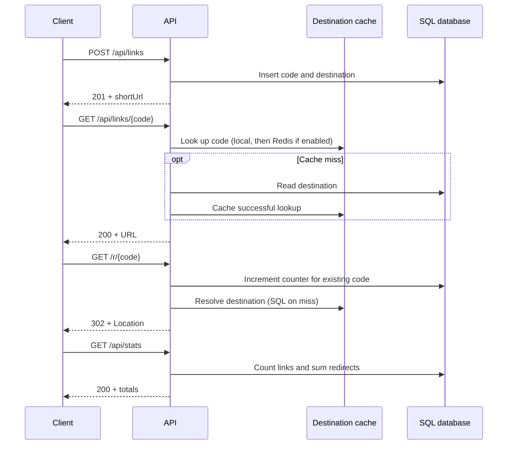

# URL Shortener

This standalone Java 21 / Spring Boot service creates short links, previews their destinations, redirects visitors, and reports aggregate usage. **Previewing is read-only; following a short link counts a visit.** A relational database owns the links and counters: file-backed H2 for local use, or PostgreSQL for a shared service. A bounded local cache and optional Redis cache accelerate destination lookups without caching visit counts.

## Run and try it

From **this `urlShortener` directory** in PowerShell, with JDK 21 on `PATH`:

```powershell
..\mvnw.cmd clean verify
java -jar .\target\links-1.0.0.jar
```

The Maven wrapper downloads dependencies on the first build. No separate database server, Docker, or API key is required. Leave the service running and use a second terminal:

```powershell
$base = 'http://127.0.0.1:8080'
$link = '{"url":"https://example.org/docs"}' | curl.exe -fsS -H 'Content-Type: application/json' --data-binary '@-' "$base/api/links" | ConvertFrom-Json
curl.exe -i "$base/api/links/$($link.code)"  # Preview: 200, no visit
curl.exe -i "$base$($link.shortUrl)"         # Redirect: 302 + Location, one visit
curl.exe -i "$base/api/stats"               # Fresh database: {"totalLinks":1,"totalRedirects":1}
```

The second command that uses `curl.exe -i` deliberately omits `-L`: it shows the redirect response without contacting the destination. The counter records redirects issued, not successful page loads at the destination.

## API contract

[`openapi.yaml`](openapi.yaml) is the OpenAPI 3.0.3 specification for **this module**. Read it directly or import it into an OpenAPI viewer. This app does not serve Swagger UI, `/docs/openapi.yaml`, or the enhanced `/api/v1` routes. Those belong to the separate [enhanced service and Swagger scenario](../scenarios/observability-api-docs/scenario.json).

| Method and path | Input | Successful response |
|---|---|---|
| `POST /api/links` | JSON `{"url":"https://example.org/docs"}`. Required: absolute HTTP(S) URI with a host, up to 4,096 characters. | `201 Created`, relative `Location: /r/{code}`, and `{"code":"…","shortUrl":"/r/…"}`. |
| `GET /api/links/{code}` | Code returned by creation. | `200`, `{"url":"https://example.org/docs"}`. No redirect, outbound fetch, or counter update. |
| `GET /r/{code}` | Code returned by creation. | `302 Found` with the stored destination in `Location` and `Cache-Control: no-store`. |
| `GET /api/stats` | None. | `200`, `{"totalLinks":1,"totalRedirects":1}`. Totals cover **all** stored links, not one code. |

Malformed create requests return `400`; unknown codes return `404` on preview and redirect. Storage or transaction failures return `503`, as does exhausting the code-allocation retry limit. URL validation checks syntax and scheme, not reachability or destination safety. This module has no custom aliases, expiry, authentication, rate limiting, or per-link statistics endpoint.

## Request flow and core logic



| Where to look | What it owns |
|---|---|
| [API](src/main/java/dev/canopy/links/api) | Controllers validate requests and map outcomes to HTTP. Advice maps storage and transaction errors to `503`. |
| [LinkService](src/main/java/dev/canopy/links/service/LinkService.java) | Implements cache-aside previews. On redirect it increments the SQL counter atomically before resolving the destination in the same transaction. Even a warm cache cannot replace a failed counter write. |
| [LinkStore](src/main/java/dev/canopy/links/persistence/LinkStore.java) and [schema.sql](src/main/resources/schema.sql) | Parameterized JDBC works with both supported databases. The primary key prevents overwrites; collisions on a random 12-hex-character code are retried up to five insert attempts total. |
| [DestinationCache](src/main/java/dev/canopy/links/cache/DestinationCache.java) | Looks up immutable destinations in Caffeine, then optional Redis. Misses go to SQL; missing links aren't cached. A Redis access failure suppresses remote calls for five seconds while local cache and SQL continue serving requests. |
| [LinkStatistics](src/main/java/dev/canopy/links/analytics/LinkStatistics.java) | Always queries SQL for the link count and sum of redirects. No asynchronous queue or cache can lose or delay an acknowledged counter increment. |
| [Java tests](src/test/java/dev/canopy/links) and [HTTP contract scenarios](src/test/resources/dev/canopy/links/preview.feature) | Cover invalid URLs, collisions, concurrent redirect counts, aggregate totals, and the difference between previewing and following a link. `clean verify` runs them against in-memory test databases. |

## Configuration and logging

Defaults come from [application.properties](src/main/resources/application.properties) and Spring Boot. Standard Spring environment variables can override them before startup:

| Parameter | Default | Why it matters |
|---|---|---|
| `SERVER_ADDRESS` / `SERVER_PORT` | `127.0.0.1` / `8080` | Loopback-only by default. Change the port if it is occupied, and update `$base` accordingly. |
| `SPRING_DATASOURCE_URL` | `jdbc:h2:file:./data/canopy` | The path is relative to the **process working directory**, not the JAR. Start from the same directory to reuse links. |
| `spring.sql.init.mode` / `spring.h2.console.enabled` | `always` / `false` | Initializes the table if absent at startup; the H2 web console is disabled. |
| `LOGGING_LEVEL_ROOT` | Spring Boot default (`INFO`) | Controls framework console verbosity. For example, set `$env:LOGGING_LEVEL_ROOT='WARN'` before `java -jar` for quieter startup. |
| `REDIS_ENABLED` / `SPRING_DATA_REDIS_URL` | `false` / unset | Enable Redis and point to a Redis instance, or set `SPRING_DATA_REDIS_HOST` and port. Access timeouts default to 500 ms. |
| `CACHE_CAPACITY` / `CACHE_TTL_SECONDS` | `4096` / `300` | Maximum local entries and destination lifetime. Never cache counts. |
| `CACHE_NAMESPACE` | `canopy-standalone` | Use a separate namespace for each backing database sharing Redis; change it after a database restore. |

### Run with PostgreSQL and Redis

From this directory, build the JAR first as above. Set `DATABASE_PASSWORD` in the environment to a local development password, then run:

```powershell
docker compose up -d
docker compose logs -f app
```

Use the same curl examples at `http://127.0.0.1:8080` (or set `APP_PORT` before startup). [Compose](compose.yaml) publishes only the application on loopback. PostgreSQL uses a named volume and both backends are private to the Compose network. `docker compose down` stops the stack without deleting the database. For an existing PostgreSQL database outside Compose, set `SPRING_DATASOURCE_URL`, `SPRING_DATASOURCE_USERNAME`, and `SPRING_DATASOURCE_PASSWORD`; the database user must be able to initialize the schema. Redis is optional in either mode.

**Logging scope:** there is no custom per-request logger, structured JSON event, or correlation-ID filter in this module. Use HTTP status and `Location` to inspect an individual response, and `/api/stats` to verify counts. The [brownfield telemetry example](../scenarios/observability-api-docs/) demonstrates structured request logging on the enhanced workload, not this standalone app.
